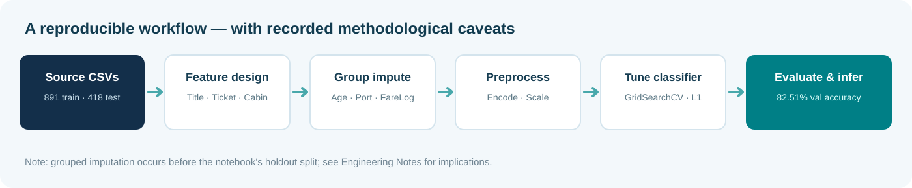
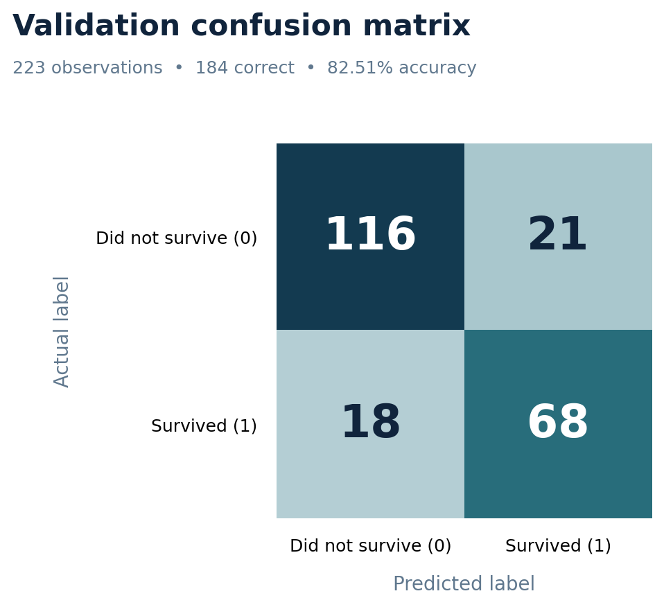
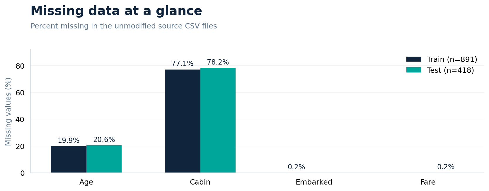

<div align="center">


# Titanic Survival Prediction

**Feature-rich machine learning for a classic binary-classification challenge**

From raw passenger records to reproducible local validation, interpretable feature engineering, tuned logistic regression, and a competition-ready prediction file.

**Python / Jupyter** · **pandas / scikit-learn** · **EDA** · **Feature Engineering** · **Model Selection**

[**Explore the notebook**](Notebooks/Titanic.ipynb) · [**Read the final report**](docs/FINAL_REPORT.md) · [**PDF report**](docs/FINAL_REPORT.pdf) · [**Reproduce the analysis**](docs/REPRODUCIBILITY.md) · [**Inspect the submission**](outputs/submission.csv)

</div>

---

## Project at a glance

| Training passengers | Test passengers | Saved validation accuracy | Best 5-fold CV weighted F1 |
|:--:|:--:|:--:|:--:|
| **891** | **418** | **82.51%** | **0.8219** |

> **Evidence and scope.** These performance values come from the **original notebook's saved execution outputs**, not a new training run or an external leaderboard. The 223-row holdout confusion matrix contains 184 correct predictions. See the [final report](docs/FINAL_REPORT.md#5-evaluation-and-results) for the distinction between cross-validation and holdout results.

## Why this project exists

The Titanic survival-prediction problem introduces a realistic machine-learning workflow: imperfect real-world-looking tabular data, missing observations, heterogeneous categorical and numerical predictors, model selection, and prediction export.

This project investigates how passenger titles, travel class, age, cabin and ticket metadata, family context, and ticket fare relate to the **binary `Survived` label** in the supplied labeled data. The unlabeled test set is used only for inference.

### What's inside

- **Data exploration:** training/test schema, class distribution, null audit, duplicates, numeric summaries, and outlier visualizations.
- **Feature engineering:** titles, ticket tokens and length, cabin deck and count, family size, solitary travel indicator, missing-age indicator, log transforms.
- **Missing-value treatment:** title/class-grouped median, mean, and mode imputation.
- **Model preparation:** stratified 75/25 holdout, ordinal encoding, one-hot encoding, standardized numeric fields, and count encoding for ticket prefixes.
- **Modeling:** LazyPredict algorithm screening followed by a regularized logistic-regression pipeline.
- **Optimization:** 132 grid candidates × 5 folds = **660 model fits** in the stored run.
- **Evaluation:** classification report, confusion matrix, and competition submission.



## Key results

<div align="center">



</div>

| Validation result | Value |
|---|---:|
| Evaluated observations | 223 |
| Correct classifications | 184 |
| Incorrect classifications | 39 |
| Accuracy | **82.51%** |
| Survival precision (`1`) | 76.40% |
| Survival recall (`1`) | 79.07% |
| Survival F1 (`1`) | 77.71% |
| Mean CV weighted F1 for selected configuration | 82.19% |

**Best recorded logistic-regression parameters:** `C=1`, `class_weight=None`, `l1_ratio=1`, `solver='saga'`. The held-out validation performance is **not** a competition test score; the supplied notebook does not record a Kaggle submission result.

### Data quality snapshot



`Age` and `Cabin` have substantial missingness. The notebook preserves missing-age information in a derived indicator, converts cabin information into categorical/deck features, and uses group-based imputers for age, embarkation, and log fare. See the [data dictionary](docs/DATA_DICTIONARY.md) for the precise definitions.

## Repository layout

```text
Titanic-Disaster-GitHub/
├── .github/
│   ├── ISSUE_TEMPLATE/
│   ├── workflows/quality.yml
│   └── pull_request_template.md
├── Data/
│   ├── train.csv
│   └── test.csv
├── Notebooks/
│   └── Titanic.ipynb                 # Original Python cells; expanded English Markdown
├── assets/                          # Original cover, diagrams and verified charts
├── docs/
│   ├── README.md                    # Documentation index
│   ├── FINAL_REPORT.md              # Detailed scientific and project report
│   ├── FINAL_REPORT.pdf             # Six-page designed summary report
│   ├── MODEL_CARD.md                # Performance, intended use and caveats
│   ├── DATA_DICTIONARY.md           # Raw and engineered variables
│   ├── DATA_PROVENANCE.md           # Data attribution and publication guidance
│   ├── METHODOLOGY.md               # Exact modeling pipeline
│   ├── ENGINEERING_NOTES.md         # Limitations and improvement proposals
│   ├── REPRODUCIBILITY.md           # Setup, execution and verification
│   ├── RELEASE_NOTES.md             # Source-to-release change log
│   └── recorded_metrics.json        # Metrics traceable to saved notebook outputs
├── outputs/
│   └── submission.csv               # Original 418-row prediction snapshot
├── scripts/
│   └── validate_project.py          # Dependency-free repository validation
├── tests/
│   └── test_repository.py           # Dependency-free regression checks
├── .editorconfig
├── .gitattributes
├── .gitignore
├── CONTRIBUTING.md
├── LICENSE
├── requirements.txt
├── requirements-dev.txt
└── notebook-code-manifest.json      # SHA-256 integrity reference for 43 code cells
```

Generated CatBoost training logs were excluded from this release; they are not required to read the notebook or reproduce its saved results.

## Quick start (Windows)

This is a **notebook-first project**, not a Python package. The code in the supplied notebook uses Windows-style `..\Data\...` paths, so **Windows is the supported execution platform for the unchanged notebook**.

**1. Clone and open the repository**

```powershell
git clone https://github.com/YOUR_USERNAME/YOUR_REPO.git
cd YOUR_REPO
```

Replace the sample GitHub URL with your repository URL.

**2. Create an environment and install dependencies**

```powershell
py -3.14 -m venv .venv
.\.venv\Scripts\Activate.ps1
python -m pip install --upgrade pip
python -m pip install -r requirements.txt
```

The original notebook metadata records **Python 3.14.7**. Package versions were not fully captured; dependency installation and notebook execution have **not** been independently rerun as part of this release. See [environment notes](docs/REPRODUCIBILITY.md#2-environment-and-dependencies).

**3. Validate the contents**

```powershell
python scripts/validate_project.py
python -m unittest discover -s tests -v
```

Validation checks the dataset schemas and IDs, binary labels, saved submission, notebook format, and the **unchanged original Python cell content** and input/output CSV byte snapshots against a SHA-256 manifest. It does **not** retrain the model.

**4. Open the notebook from its own directory**

```powershell
cd Notebooks
jupyter lab Titanic.ipynb
```

Run cells from top to bottom with the repository environment selected as the notebook kernel. A successful run writes a new `Notebooks/submission.csv`, while the original verified submission remains at [`outputs/submission.csv`](outputs/submission.csv). Model screening and grid search may take considerable time.

**Linux/macOS note:** the repository's static validation works across platforms, but running the notebook unchanged is not guaranteed because its CSV path literals use Windows backslashes. See [engineering notes](docs/ENGINEERING_NOTES.md).

## Documentation

| Resource | Question answered |
|---|---|
| [Final report (Markdown)](docs/FINAL_REPORT.md) | What was done, why, what was measured, and what was concluded? |
| [Final report (PDF)](docs/FINAL_REPORT.pdf) | Designed six-page report for sharing or portfolio review |
| [Methodology](docs/METHODOLOGY.md) | What are the exact preprocessing and modeling stages? |
| [Model card](docs/MODEL_CARD.md) | Where can the model be used, and what are its limitations? |
| [Data dictionary](docs/DATA_DICTIONARY.md) | What does each input and derived feature mean? |
| [Data provenance](docs/DATA_PROVENANCE.md) | Where does the CSV schema originate and what needs attribution? |
| [Reproducibility](docs/REPRODUCIBILITY.md) | How do I run or validate this project? |
| [Engineering notes](docs/ENGINEERING_NOTES.md) | What caveats remain without modifying the code? |
| [Release notes](docs/RELEASE_NOTES.md) | What changed in this GitHub edition? |

## Reproducibility, integrity, and scientific caution

The original **43 executable Python cell sources are unchanged**. Existing Markdown cells were expanded, new explanatory Markdown cells were added, and warning-only outputs containing a local workstation path were removed. The original code sources can be verified using the included manifest and validator.

This study uses **pre-split grouped imputation**, which allows the holdout feature distribution to contribute to some imputation statistics. Algorithm screening also reviews the same holdout later used to report the selected model's metrics. Both choices can make the performance estimate less independent than a rigorous, fully nested evaluation. These limitations are documented openly; silently changing the notebook would violate this release's code-preservation requirement.

## License and dataset attribution

Project code and newly created documentation/visualizations are released under the included [MIT License](LICENSE) (review this license choice before publication). The source Titanic CSVs are **third-party benchmark data** and are **not** relicensed by the project's MIT file. The files match the common [Kaggle Titanic competition](https://www.kaggle.com/competitions/titanic/data) schema, but original acquisition/provenance and redistribution permission should be confirmed by the repository owner. See [data provenance](docs/DATA_PROVENANCE.md).

---

<div align="center"><sub>Portfolio project · Reusable documentation · Transparent evaluation · Preserved notebook code</sub></div>
