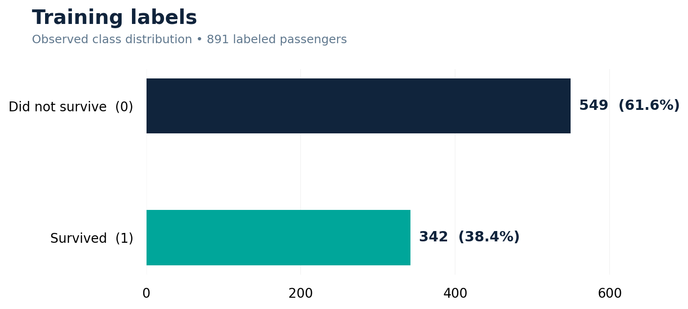
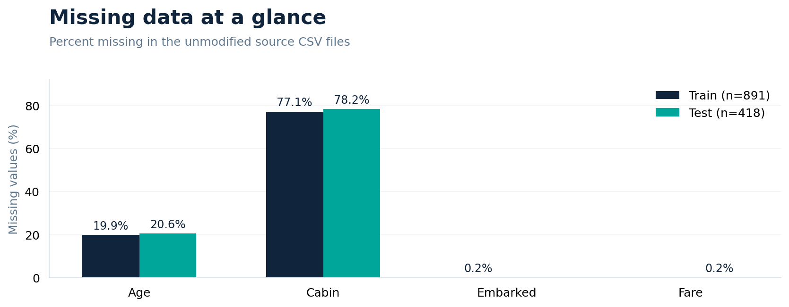
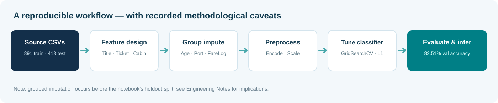
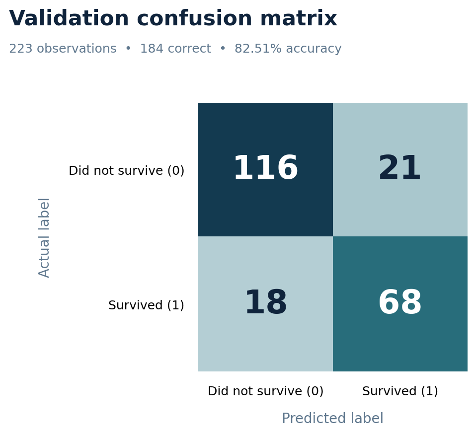

# Final Project Report

## Titanic Passenger Survival Prediction

**Project category:** Supervised learning / binary classification  
**Deliverable:** Jupyter research notebook, validated dataset snapshots, documented evaluation and a competition-format prediction file  
**Report date:** 19 November 2026  
**Evaluation status:** Retrospective report based on the notebook's existing saved outputs; no fresh retraining or leaderboard submission is claimed


---

## Executive summary

This case study models passenger survival on the Titanic using a supplied dataset with **891 labeled training rows** and **418 unlabeled test rows**. The workflow includes initial dataset auditing, handcrafted features from passenger records, targeted missing-value treatment, categorical and numerical encoding, several model benchmarks, and a regularized logistic-regression pipeline tuned with five-fold cross-validation.

The notebook's saved execution reports an **82.51% validation accuracy** on **223 holdout passengers** (`184/223` correctly classified). For the positive (survived) class, the derived precision is **76.40%**, recall **79.07%**, and F1 **77.71%**. The chosen regularization configuration has a recorded **five-fold weighted-F1 score of 0.821876** on the training subset. A prediction file contains **418 binary test predictions** and the associated passenger identifiers.

These outcomes provide evidence of a coherent applied machine-learning exercise, but **do not establish general deployment suitability**. Imputation is performed before the holdout split, model screening inspects the holdout, and no true labels for the external test file are included. The original code is preserved in the GitHub edition; identified caveats are addressed in the documentation rather than silently altering the implementation.

## 1. Objective and analytical framing

**Research question.** Using the recorded attributes of a Titanic passenger, can a supervised classifier infer the binary label `Survived`?

**Target definition.** `Survived=0` means the record is labeled as a non-survivor; `Survived=1` means the record is labeled as a survivor.

**Input data.** Passenger-level fields include passenger class, name, sex, age, family-member counts, ticket, fare, cabin, and embarkation. The train and test CSV files follow the well-known Titanic challenge layout. Their exact provenance was not established from embedded metadata in the supplied archive and should be checked by the owner.

**Scope.** This project is a case study in prediction and feature engineering. It is not a historical causal analysis, fairness audit, or real-world safety-decision system. The labeled/unlabeled competition split is retained as provided.

## 2. Data inventory and exploratory findings

| Dataset | Observations | Fields | Label `Survived` |
|---|---:|---:|---|
| `Data/train.csv` | 891 | 12 | Present |
| `Data/test.csv` | 418 | 11 | Absent |

### 2.1 Target balance



The labeled train set contains **549 non-survivors (61.62%)** and **342 survivors (38.38%)**. A naive majority-class prediction would therefore yield approximately **61.62% accuracy on the full labeled dataset**, although this is **not** a model baseline actually fitted and evaluated in the original notebook. The target distribution motivates examining balanced metrics and positive-class recall in addition to accuracy.

### 2.2 Missingness



| Field | Missing, train | Missing, test | Handling observed in notebook |
|---|---:|---:|---|
| `Age` | 177 | 86 | Grouped median of `Age`, with `AgeMissing` indicator |
| `Cabin` | 687 | 327 | `CabinDeck='Unknown'` and `CabinCount=0` for absent cabins |
| `Embarked` | 2 | 0 | Grouped mode where missing |
| `Fare` | 0 | 1 | `ln(Fare + 1)`, then grouped mean on `FareLog` |

The raw training and test data each contain **zero exact duplicate rows**. The notebook also plots numeric feature distributions using horizontal boxplots; it **does not remove outlier observations**.

### 2.3 Illustrative observed associations

In the training data, the survival-label rate is approximately **74.20%** for female passengers and **18.89%** for male passengers. By passenger class, it is **62.96% in first**, **47.28% in second**, and **24.24% in third class**. These are straightforward descriptive associations in a particular historical dataset, **not causal effects**. They illustrate why demographic and passenger-context variables may carry predictive information.

## 3. Feature engineering and missing-value treatment

The notebook constructs explanatory variables to expose patterns hidden in raw text, relationship counts and missingness.

| Input | Created predictor(s) | Purpose / precise logic |
|---|---|---|
| Name | `Title` | Parse honorific into `Mr`, `Mrs`, `Miss`, `Master`, or `Rare` |
| Ticket | `TicketPrefix`, `TicketNumber`, `TicketLength` | Extract normalized prefix, apply `ln(number+1)`, retain ticket-string length |
| Cabin | `CabinDeck`, `CabinCount` | First deck letter and number of space-separated cabin designations |
| Family | `FamilySize`, `IsAlone` | `SibSp + Parch + 1`; flag whether both family counts are zero |
| Age | `AgeMissing` | Flag whether `Age` was missing prior to imputation |
| Fare | `FareLog` | `ln(Fare + 1)` |

The original `Name`, `Ticket`, `Cabin`, `SibSp`, `Parch` and `Fare` fields are dropped after their features are extracted. The source passenger identifier is later excluded from modeling, but preserved for the exported submission.

Next, missing values are imputed by `(Title, Pclass)` groups: median for `Age`, mode for `Embarked`, and mean for `FareLog`. The same functions operate on training and test frames, but each frame calculates its **own** group summaries. This is an important reproducibility detail, as is the fact that the imputation is performed **before** the train/validation split.

## 4. Model development



### 4.1 Train / validation design

The notebook uses a **stratified 75/25 split** (`random_state=42`, `shuffle=True`), creating **668 fitting records** and **223 validation records**. The separate 418-row competition test set provides no ground-truth labels and is reserved for prediction output.

### 4.2 Transformation strategy

The code uses a `ColumnTransformer` with: ordinal encoding for `Sex`; one-hot encoding for `Embarked`, `Title`, and `CabinDeck`; standardization for selected numeric columns; count encoding followed by standardization for `TicketPrefix`; and passthrough for remaining engineered columns. DataFrames generated by `.fit_transform` and `.transform` serve the model-screening stage.

For the selected logistic-regression estimator, an end-to-end `Pipeline` contains the transformer and the classifier, so cross-validation fits transformation steps within the pipeline on each training fold. This **does not reverse** the earlier feature-engineering and grouped-imputation-before-split limitation.

### 4.3 Algorithm screening

LazyPredict benchmarks multiple methods on the designated training and validation partitions. In the saved ranking, **LinearSVC** leads the shown first ten entries with approximately **83.41%** accuracy; the unspecialized LogisticRegression entry shows approximately **81.61%** accuracy. These values are screening results rather than nested, independent estimates. The notebook subsequently chooses to explore a **regularized logistic regression** model in depth; it does not claim that logistic regression outranks all screened methods.

### 4.4 Regularization search

A grid spanning L1, L2 and elastic-net-style `l1_ratio` settings contains **132 hyperparameter combinations**. The `GridSearchCV` object uses five folds, weighted F1 (`f1_weighted`) and parallel evaluation, resulting in **660 planned and recorded fits**.

The winning recorded parameters are:

```text
logisticregression__C:             1
logisticregression__class_weight:  None
logisticregression__l1_ratio:      1
logisticregression__solver:        saga
```

**Best mean cross-validation weighted F1:** `0.8218763593070856`. This is a training-fold selection score; it must not be confused with the validation accuracy or an external competition score.

## 5. Evaluation and results

### 5.1 Saved confusion matrix



The original notebook stores the following matrix (rows = actual class, columns = predicted class):

| Actual / predicted | Predicted `0` | Predicted `1` |
|---|---:|---:|
| **Actual `0`** | 116 (TN) | 21 (FP) |
| **Actual `1`** | 18 (FN) | 68 (TP) |

The matrix totals **223** observations and includes **39** mistakes. In this binary-label convention, true positive means *survival predicted and labeled as survival*. The same matrix yields:

| Metric | Definition | Result |
|---|---|---:|
| Accuracy | `(TP + TN) / N` | **0.825112 = 82.51%** |
| Precision, class `1` | `TP / (TP + FP)` | **0.764045 = 76.40%** |
| Recall, class `1` | `TP / (TP + FN)` | **0.790698 = 79.07%** |
| F1, class `1` | `2TP / (2TP + FP + FN)` | **0.777143 = 77.71%** |
| Correct predictions | `TP + TN` | **184** |
| Misclassifications | `FP + FN` | **39** |

The saved `classification_report` reports approximately **0.83 accuracy**, as expected from rounding to two decimal places. Its class-1 precision, recall and F1 also agree with the calculations above after rounding.

### 5.2 Interpretation of errors

Among 86 actual surviving passengers in the holdout, **18** are predicted as non-survivors (**20.93% false-negative rate for class 1**). Among 137 actual non-survivors, **21** are predicted as survivors (**15.33% false-positive rate for class 0**). The asymmetric error rates matter: accuracy alone would obscure the difference between detecting survival and detecting non-survival.

### 5.3 Submission artifact

The notebook creates a **418 × 2** CSV with columns `PassengerId` and `Survived`, with **243 predicted zeros and 175 predicted ones**. A preserved snapshot is in [`outputs/submission.csv`](../outputs/submission.csv). The provided materials contain **no Kaggle leaderboard accuracy, rank, or competition feedback**. Without test ground-truth labels, public-test performance cannot be verified from this archive.

## 6. Scientific and engineering limitations

1. **Pre-split imputation:** Title/class-derived imputation values are computed before isolating the validation set, using feature observations from future validation rows. This is information leakage at the preprocessing-statistics level, even without target labels.
2. **Repeated validation use:** The designated holdout is inspected during LazyPredict model screening and later used again to report the tuned logistic regression. That means the holdout is not strictly untouched throughout model selection.
3. **Train/test imputation mismatch:** Group statistics are recomputed separately on unlabeled test data. A deployment-ready preprocessing pipeline would fit reusable imputers on training data and apply those fitted values consistently.
4. **Potential edge cases:** Ticket-number parsing, `mode()[0]` on empty groups, and unhandled all-null groups do not have general-purpose defensive fallbacks.
5. **Small dataset and outcome context:** The 891-row labeled dataset is limited in size. The observed correlations may not extend to other travel populations, periods, or use cases.
6. **Version portability:** The notebook records Python 3.14.7 and uses Windows backslashes for relative paths. No complete dependency lockfile or fresh cross-platform notebook execution is contained in the source material.
7. **No Kaggle test score:** Submission predictions alone do not establish correctness on unlabeled competition data.
8. **Model fairness and causality:** Features such as sex, age and class reflect sensitive or socially patterned characteristics. This is an educational historical prediction exercise, not an ethically validated decision system.

These limitations are deliberately **documented, not fixed in code**, to honor the requirement to keep every executable notebook cell unchanged.

## 7. Recommended next experiments (not implemented)

- Move all learned imputation into a fit/transform preprocessing pipeline, and split before estimating imputation statistics.
- Use a fixed train-only imputer for future validation and test transformations; add fallback values for unseen or entirely missing groups.
- Use nested cross-validation, or reserve a final untouched test partition for unbiased model comparison.
- Quantify uncertainty with stratified repeated CV and report variance/intervals rather than a single accuracy number.
- Add probability calibration, decision-threshold analysis, and subgroup error diagnostics.
- Improve ticket parsing robustness; reduce row-wise loops with vectorization where possible.
- Make data paths platform-independent in a future explicitly approved code revision.
- Capture an actual tested dependency lockfile and training environment snapshot.

No experiment in this list is represented as completed.

## 8. Project deliverables and verification

| Deliverable | Location | Verification |
|---|---|---|
| Original executable notebook workflow with expanded English explanation | `Notebooks/Titanic.ipynb` | Code-cell SHA-256 comparison using `notebook-code-manifest.json` |
| Labeled and unlabeled data snapshots | `Data/` | CSV schema, row count and identifier checks |
| Submission prediction snapshot | `outputs/submission.csv` | 418 unique matching test IDs, columns, binary labels |
| Final report and reference documentation | `docs/` | Figures and metrics tied to stored outputs |
| Static repository checks | `scripts/`, `tests/`, `.github/workflows/` | Dependency-free checks; no model retraining |

**Conclusion.** The project demonstrates an end-to-end classification workflow with meaningful feature construction, a reproducible training split, a comparative model-screening phase and tuned logistic-regression evaluation. The saved holdout result is **82.51% accuracy** with **76.40% precision** and **79.07% recall** for the survival class. Because the experiment contains documented preprocessing and validation caveats, the appropriate claim is **a well-documented educational benchmark with preserved source code**, not a production-ready classifier or a verified competition leaderboard result.

---

**Evidence sources (included locally):** [`Notebooks/Titanic.ipynb`](../Notebooks/Titanic.ipynb), [`Data/train.csv`](../Data/train.csv), [`Data/test.csv`](../Data/test.csv), [`outputs/submission.csv`](../outputs/submission.csv), and [`recorded_metrics.json`](recorded_metrics.json). Read [Reproducibility](REPRODUCIBILITY.md) for the exact validation procedure.
