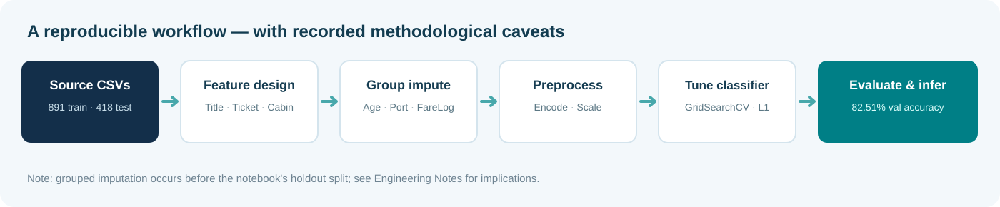

# Modeling Methodology

> Scope: faithful explanation of the original notebook's executable code. This document does not silently replace its processing sequence or modeling decisions.

## Data flow

1. Read `Data/train.csv` and `Data/test.csv` relative to `Notebooks/` (Windows-style paths in source).
2. Inspect data structure, summary statistics, exact duplicate counts, missingness and numeric boxplots.
3. Call `feature_engineering` on **each** CSV DataFrame.
4. Fill missing engineered values using `(Title, Pclass)`-grouped imputers **before** the train/validation split.
5. Build `X_train`, `y_train` and `X_test`; exclude `PassengerId` and exclude the target from predictors.
6. Stratified split with `test_size=0.25`, `random_state=42`, `shuffle=True`.
7. Fit a `ColumnTransformer` on the fitting subset, then transform validation and test subsets.
8. Use LazyPredict for exploratory model comparison on the transformed feature matrices.
9. Construct a full transformer + logistic-regression pipeline, run `GridSearchCV` with five folds, select its `best_estimator_`.
10. Predict on the 223-row validation subset; print classification report and confusion matrix.
11. Predict 418 unlabeled competition test rows; export `PassengerId,Survived` as `submission.csv`.

## Engineered fields

### Title

Looks for text markers in passenger names in order: `Mr.`, `Mrs.`/`Mme.`, `Miss.`/`Ms.`/`Mlle.`, and `Master.`. All other patterns become `Rare`. This is an explicit rule-based parser, not an external language model.

### Ticket features

Normalizes the ticket string to uppercase. In multi-part tickets, all tokens before the last are joined to a prefix (with slashes and periods removed) and the last token is converted to a numeric suffix. A single numeric string is assigned prefix `NONE`; single-token alphabetic tickets receive `TicketNumber=0`. The numeric suffix becomes `ln(TicketNumber+1)`. The original raw string length is recorded in `TicketLength`.

The code assumes the observed input formats and may fail if the last token is not parseable as an integer when the multi-part branch is used.

### Cabin features

For non-null cabins, `CabinDeck` is the first letter and `CabinCount` is the number of space-separated cabin entries. Null cabins become `CabinDeck='Unknown'` and `CabinCount=0`. Thus the original cabin string is not passed directly to the classifier.

### Family and missingness features

`FamilySize = SibSp + Parch + 1`. `IsAlone=1` if both `SibSp` and `Parch` are zero; otherwise `0`. `AgeMissing=1` for an originally null age; otherwise `0`.

### Fare feature

`FareLog = ln(Fare+1)`. Missing `Fare` yields a missing `FareLog` before imputation.

## Imputation

| Feature | Calculation | Group keys |
|---|---|---|
| `Age` | `median()` | `Title`, `Pclass` |
| `Embarked` | `mode()[0]` | `Title`, `Pclass` |
| `FareLog` | `mean()` | `Title`, `Pclass` |

Training and test data are imputed **independently**; the imputer functions do not store a reusable training-side statistic for test inference. Because the source performs this operation before splitting, the later validation group statistics include observations beyond the fitting subset. See [Engineering Notes](ENGINEERING_NOTES.md).

## Preprocessing branches

| Branch | Columns |
|---|---|
| Ordinal | `Sex` |
| One-hot | `Embarked`, `Title`, `CabinDeck` |
| Standard-scale | `Age`, `TicketLength`, `TicketNumber`, `CabinCount`, `FamilySize`, `FareLog`, `Pclass` |
| Count + standard-scale | `TicketPrefix` |
| Passthrough | Any remaining predictor columns (for example `IsAlone`, `AgeMissing`) |

`OneHotEncoder` specifies `handle_unknown='ignore'`. The manual model-screening matrices call `.fit_transform(X_train)` and `.transform(X_val/X_test)`. The tuned logistic regression embeds the same `ColumnTransformer` inside a separate `Pipeline`.

## Model screen

`LazyClassifier(ignore_warnings=True, random_state=42, n_jobs=-1, cv=5, classifiers='all', use_gpu=False)` is called on transformed training and holdout sets. Its results are displayed and used for exploratory comparison. The `cv=5` constructor option is retained as written; this report makes no unsupported claim that LazyPredict performs nested five-fold outer validation in this call.

## Final logistic regression and search

Initial classifier: `LogisticRegression(random_state=42, n_jobs=-1, verbose=2, max_iter=5000, class_weight='balanced')`, composed with preprocessing via `make_pipeline`.

**Grid configuration**

| Regularization | L1 ratio | Solvers | C values | Weight settings | Candidates |
|---|---|---|---|---|---:|
| L1 | `[1]` | `liblinear`, `saga` | `.001, .01, .1, 1, 10, 100` | `None`, `balanced` | 24 |
| L2 | `[0]` | `lbfgs`, `liblinear`, `saga` | `.001, .01, .1, 1, 10, 100` | `None`, `balanced` | 36 |
| Elastic net | Nine values from `.1` to `.9` | `saga` | `.01, .1, 1, 10` | `None`, `balanced` | 72 |
| **Total** | | | | | **132** |

`GridSearchCV(..., cv=5, scoring='f1_weighted', n_jobs=-1, verbose=2)` runs 660 fits. Best stored parameters are `C=1`, `class_weight=None`, `l1_ratio=1`, `solver='saga'`; saved mean CV weighted-F1 is `0.8218763593070856`.

## Final validation and outputs

On the reserved validation partition, the best estimator produces `[[116,21],[18,68]]` for the confusion matrix and ~82.51% accuracy. The saved classification report provides class-wise rounded precision, recall and F1. For the separate 418-row test file, predicted binary labels are exported without a DataFrame index column.

**Do not conflate:** the best CV weighted-F1, the validation accuracy, the LazyPredict model-ranking table, and any hypothetical Kaggle leaderboard result. They answer different questions and use different evidence.
